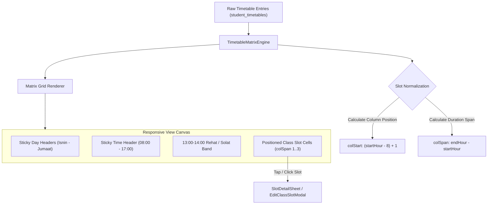

# Design Specification: PDF-Style Weekly Timetable Matrix Grid

**Date:** 2026-10-13  
**Status:** Validated & Ready for Planning  
**Target Module:** `src/components/takwim/MyTimetableView.tsx` & Timetable Sub-components  

---

## 1. Executive Summary & Objective

In Malaysian Polytechnics (POLISAS), students have traditionally referenced their official semester class timetable via the official PDF schedule (ISO form `POLISAS-PK-02(1c)`). This document organizes the week into a **5-day × 9-hour matrix** (Isnin–Jumaat, 08:00–17:00), making gaps between classes, multi-hour lab sessions, and the daily 13:00–14:00 lunch/prayer break immediately visible at a single glance.

The current system implementation in `MyTimetableView.tsx` defaults to an `agenda` list view and its `grid` view merely renders 5 stacked columns without time-slot alignment. 

This design upgrades the timetable experience into an **interactive, modern institutional PDF-Style Weekly Matrix Grid**:
1. **Matrix Layout:** 5 Day Rows (Isnin–Jumaat) × 9 Hourly Columns (08:00 to 17:00) with accurate time positioning and multi-hour `col-span`.
2. **Mobile Responsive Architecture:** Full swipeable horizontal canvas with a **Sticky Left Day Column**, allowing students on mobile to smoothly scan morning-to-afternoon hours without losing track of the day.
3. **Dedicated Rehat / Solat Column:** 13:00–14:00 is visually demarked across all days with subtle diagonal striping and clean institutional labeling.
4. **Interactive Slot Detail Sheet / Popover:** Tapping any slot reveals full details (Course Name, Code, Room, Lecturer, Credit Hours) with a one-tap action to edit the slot (`EditClassSlotModal`). No bulky table below the grid.
5. **Smart Persistence & Default View:** Defaults to `grid` view for new sessions, while persisting user toggle preference (`grid` vs `agenda`) in `localStorage`.

---

## 2. Architecture & Data Flow

### 2.1 Time Slot Indexing
The standard POLISAS class schedule spans 9 active hours:
- Column 1: `08:00 - 09:00`
- Column 2: `09:00 - 10:00`
- Column 3: `10:00 - 11:00`
- Column 4: `11:00 - 12:00`
- Column 5: `12:00 - 13:00`
- Column 6: `13:00 - 14:00` (*Waktu Rehat & Solat Rasmi*)
- Column 7: `14:00 - 15:00`
- Column 8: `15:00 - 16:00`
- Column 9: `16:00 - 17:00`

If an exceptional slot extends beyond 17:00 (e.g. up to 18:00), the matrix dynamically expands to Column 10 (`17:00 - 18:00`) automatically.

---

## 3. UI/UX Specifications

### 3.1 Weekly Matrix Table Structure
- **Container:**
  - `overflow-x-auto rounded-2xl border border-slate-200/80 dark:border-white/10 bg-white dark:bg-white/[0.02] shadow-xs`
  - Min-width: `960px` (or `minmax(100px, 1fr)` per column) ensuring each cell is comfortably readable without ugly line wraps.
- **Sticky Column 0 (Day Labels):**
  - Width: `w-20 sm:w-24` (80px - 96px).
  - CSS: `sticky left-0 z-20 bg-slate-50/95 dark:bg-zinc-900/95 backdrop-blur-xs border-r border-slate-200/80 dark:border-white/10`.
  - Content: Day name (`ISNIN`, `SELASA`, `RABU`, `KHAMIS`, `JUMAAT`).
  - Active Day ("Hari Ini"): Highlighted with an indigo pill badge or border accent.
- **Top Header Row (Time Slots):**
  - CSS: `sticky top-0 z-30 bg-slate-100/90 dark:bg-zinc-900/90 backdrop-blur-xs border-b border-slate-200 dark:border-white/10 text-[10px] font-black uppercase tracking-wider text-slate-500 dark:text-white/40 py-2.5 px-2 text-center`.
  - Corner Cell (Top-Left): `sticky top-0 left-0 z-40 bg-slate-100 dark:bg-zinc-900`.
- **Break Time Column (13:00 - 14:00):**
  - Visually distinct with a subtle muted pattern or soft slate tint (`bg-slate-50/60 dark:bg-white/[0.015]`).
  - When empty, renders a subtle vertical watermark / text: `"REHAT"` or `"REHAT / SOLAT"`.
  - If a user has a class booked during this hour, the class card sits cleanly on top.

### 3.2 Slot Card Visual Aesthetics
- **Card Background:** Soft institutional color matching course palette:
  - Background: `hexToRgba(color, 0.10)`
  - Border: `1px solid hexToRgba(color, 0.35)`
  - Left Accent Bar: `3px solid color`
- **Typography & Content inside Cell:**
  - Course Code & Type: e.g. `DEE30163 (L)` in bold `text-xs font-black text-slate-900 dark:text-white tracking-tight leading-none`.
  - Room / Location: e.g. `EA301` with subtle building badge or pin icon (`text-[10px] font-bold text-slate-600 dark:text-white/70`).
  - Lecturer: e.g. `FZA` in `text-[9px] font-medium text-slate-500 dark:text-white/50 truncate`.
- **Interactive Feedback:**
  - Hover: `hover:shadow-md hover:scale-[1.01] hover:border-indigo-500/50 transition-all cursor-pointer`.
  - Tap / Click: Opens the quick detail popover / sheet with direct link to `EditClassSlotModal`.

### 3.3 Default View & Preference Persistence
- `localStorage` key: `'jpp_student_timetable_view'` (`'grid' | 'agenda'`).
- Initial fallback: `'grid'` (making the PDF-style Matrix the default experience as requested).
- Toggling between `Grid` and `Agenda` instantly updates both local state and `localStorage`.

---

## 4. Error Handling & Edge Cases

1. **Non-Standard Time Slots (e.g., 08:30 - 10:30):**
   - The grid positioning algorithm rounds start/end times or computes fractional grid placement so odd-minute slots render cleanly without breaking adjacent columns.
2. **Overlapping Slots / Conflicts:**
   - If two classes share the same day and overlapping time window, they are rendered side-by-side or stacked within the column span with a small amber warning indicator badge (`Konflik Masa`).
3. **Empty Week (No Entries):**
   - Displays a clean empty state with quick action buttons (`MUAT NAIK JADUAL` and `Isi Jadual Manual`), identical to existing design.
4. **Touch Devices & Mobile UX:**
   - Momentum horizontal scrolling with `-webkit-overflow-scrolling: touch`.
   - Subtle scroll hint indicator on mobile (e.g., `"← Leret untuk lihat jadual penuh →"`), fading out after user scrolls.

---

## 5. Verification & Testing Plan

1. **Unit Tests (`src/__tests__/TimetableMatrixGrid.test.tsx`):**
   - Test column indexing for 1-hour, 2-hour, and 3-hour classes.
   - Test sticky day headers and 13:00–14:00 break column rendering.
   - Test `localStorage` view mode persistence and default fallback to `'grid'`.
   - Test click-to-view/edit slot interaction.
2. **Visual & Responsive Verification:**
   - Verify desktop view (> 1024px) renders all 9 time slots + day column in a single cohesive canvas.
   - Verify mobile view (< 640px) enables horizontal scroll while keeping the day column sticky on the left.
   - Verify dark mode parity and high contrast.
3. **Build & Regression Suite:**
   - Run `npm test` across all 540+ tests.
   - Run `npm run build` to confirm zero TypeScript compilation errors.
