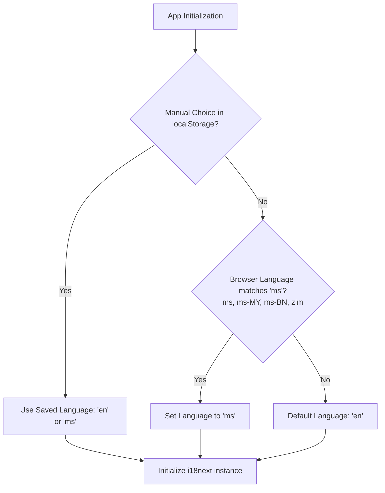

# Specification: Multilingual Support (English & Bahasa Melayu)

**Date:** 2026-10-19  
**Status:** Approved for Implementation Planning  
**Target:** JPP-POLISAS Student & Management Super App  

---

## 1. Executive Summary

JPP-POLISAS currently operates exclusively in Bahasa Melayu (BM). To accommodate a broader audience, international partnerships, and students whose primary operating language is English, the platform requires an extensible internationalization (i18n) framework supporting dual languages:
- **English (`en`)**
- **Bahasa Melayu (`ms`)**

This specification defines the foundational architecture, language detection and resolution algorithm, translation dictionary layout, UI switcher components, and the Phase 1 rollout across the global app shell (Header, Sidebar, Authentication, and Settings).

---

## 2. Goals & Non-Goals

### Goals
- **Smart Default & Auto-Detection**:
  - Default to English (`en`) for general visitors.
  - Automatically detect and switch to Bahasa Melayu (`ms`) if the user's browser/system locale indicates Malay (`ms`, `ms-MY`, `ms-BN`, `zlm`).
  - Honor manual user overrides saved in `localStorage` (`jpp_language`).
- **Standardized i18n Foundation**: Use `i18next` and `react-i18next` for high-performance, reactive translation handling without full page reloads.
- **Modular Namespacing**: Store translation dictionaries in split JSON namespaces (`common`, `auth`, `nav`, `settings`) under `src/locales/{en,ms}/`.
- **Global Shell Integration (Phase 1)**:
  - Global `LanguageToggle` component matching the glassmorphic aesthetic of `ThemeToggle`.
  - Mounted in `Header.tsx`, `LoginPage.tsx`, and `SettingsPage.tsx`.
  - Primary navigation in `Sidebar.tsx` and header elements dynamically translated.
- **Extensible for Future Modules**: Establish clean patterns for upcoming module translations (e-KPP, Keusahawanan, Kebajikan, Karnival, EMS).

### Non-Goals
- Changing database schema or altering `profiles` table in Supabase in this phase (pure client-side persistence in `localStorage` avoids risky migration overhead under heavy load).
- Altering URL paths or route prefixes (e.g. no `/en/...` or `/ms/...` paths), preserving all bookmarkable routes and deep links defined in `ROUTES.md`.
- Mass translating all deep module sub-pages in Phase 1 (e.g., specific PDF templates or 50+ granular CRUD forms); these will be added progressively using the namespace pattern established here.

---

## 3. Language Resolution Logic

The initial language is determined synchronously upon app initialization before React renders:



### Detection Logic in `src/lib/i18n.ts`:
1. Check `localStorage.getItem('jpp_language')`. If value is `'en'` or `'ms'`, use it.
2. Otherwise, check `navigator.language` and `navigator.languages`. If any tag begins with `ms` or contains `malay`, use `'ms'`.
3. Fallback: `'en'`.
4. Fallback behavior: If any key is missing in `'ms'` or `'en'`, i18next falls back to `'en'`.

When the user changes language via `LanguageToggle`:
1. Call `i18n.changeLanguage(newLang)`.
2. Persist `localStorage.setItem('jpp_language', newLang)`.
3. Set `document.documentElement.lang = newLang`.

---

## 4. Architecture & File Structure

```text
src/
├── lib/
│   └── i18n.ts                      # i18next configuration & custom detector
├── locales/
│   ├── en/
│   │   ├── common.json              # Shared actions, status labels, dialogs, buttons
│   │   ├── auth.json                # Login, onboarding, reset password strings
│   │   ├── nav.json                 # Sidebar routes, header titles, search placeholders
│   │   └── settings.json            # Profile, theme, and language settings labels
│   └── ms/
│       ├── common.json
│       ├── auth.json
│       ├── nav.json
│       └── settings.json
├── components/
│   └── ui/
│       └── LanguageToggle.tsx       # Language switcher dropdown/pill component
```

### Namespace Definitions:
- `common`: Generic UI elements (`save`, `cancel`, `loading`, `error`, `success`, `confirm`, `delete`, `search`).
- `auth`: Login form labels (`email`, `matrix_no`, `password`, `login_button`, `forgot_password`, validation messages).
- `nav`: Main navigation titles (`dashboard`, `clubs`, `activities`, `reports`, `settings`, `jpp_portal`, `portal_student_title`).
- `settings`: Tab titles and language configuration controls.

---

## 5. UI Components & Placement

### 5.1 `LanguageToggle.tsx`
- Modeled after `src/components/ui/ThemeToggle.tsx`.
- Uses `DropdownMenu` with options:
  - English (`EN`) — with UK flag or subtle language indicator.
  - Bahasa Melayu (`BM`) — with Malaysia flag or subtle language indicator.
- Accessible aria labels and keyboard navigation.

### 5.2 Header Integration (`src/components/layout/Header.tsx`)
- Placed immediately adjacent to `<ThemeToggle />` on the right side of the header.
- Keeps responsive spacing consistent across mobile and desktop.

### 5.3 Login Page Integration (`src/pages/LoginPage.tsx`)
- Positioned in the top right corner of the login screen to allow international or English-preferring students to switch languages before authenticating.

### 5.4 Settings Page Integration (`src/pages/SettingsPage.tsx`)
- Inside the "Paparan & Tema" tab (enhanced to "Paparan & Bahasa").
- Provides a dedicated selection card for Language (English vs Bahasa Melayu) with a brief preview of the active language.

---

## 6. Guidelines & Compliance

Per `.agents/AGENTS.md` and `DEV_GUIDELINE.md`:
- **No changes to Supabase client singleton**: `src/lib/supabase.ts` remains untouched.
- **No global realtime subscriptions added**: Translations are entirely static JSON bundles bundled via Vite's dynamic imports or direct imports.
- **Performance**: JSON resources are lightweight (<15KB each) and bundled cleanly with Vite tree-shaking.
- **Documentation Obligation**: Upon completing the tasks, `DEV_GUIDELINE.md` must be updated to document the new `src/lib/i18n.ts` architecture and `LanguageToggle` component.

---

## 7. Testing & Verification

1. **Unit Tests (Vitest)**:
   - Test `getInitialLanguage()` detector:
     - Returns saved language from `localStorage` if set.
     - Returns `'ms'` if `navigator.language` is `'ms-MY'`.
     - Returns `'en'` if `navigator.language` is `'en-US'`.
     - Returns `'en'` as default fallback if `navigator.language` is any other language.
2. **Translation Key Consistency Check**:
   - Automated script or unit test to verify that every key in `en/*.json` exists in `ms/*.json` and vice versa.
3. **Manual UI Verification**:
   - Verify toggle in Header switches UI text in real-time.
   - Verify toggle on Login Page updates login labels without page refresh.
   - Verify Settings Page shows current language selection.
   - Verify refresh persists the selected language.
